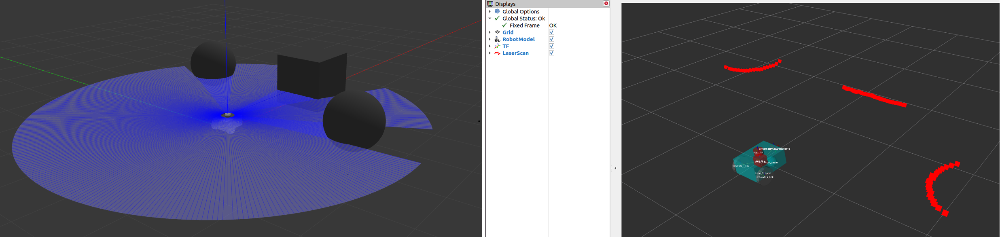
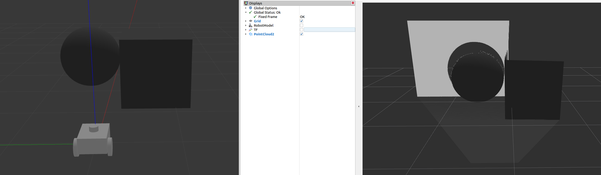
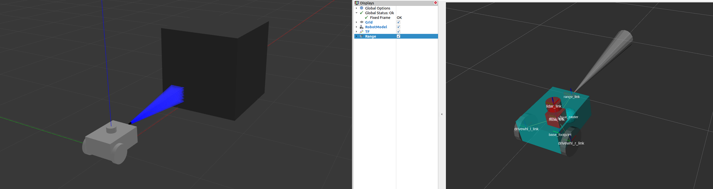
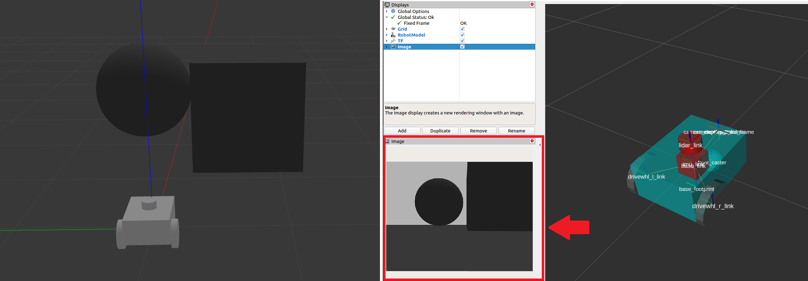

# Setting Up Sensors

In this guide we discuss the sensors on SKD-1, how they are driven on the real robot, how they are
simulated in Gazebo, and how to verify their data in RViz. Sensors are used for mapping,
localization and perception. In the [next guide](mapping_localization.md) we configure SLAM and the
costmaps that consume the data.

## Sensor Introduction

Mobile robots are equipped with sensors that allow them to perceive their environment. The
information is used to build a map, to localize the robot on it, and to see obstacles. To
standardize message formats between vendors, ROS provides the `sensor_msgs` package. Drivers
publish standard messages so that software such as Nav2 works independently of the sensor
hardware. Gazebo sensor plugins publish the same messages for the simulated robot.

> [!NOTE]
> **See also:**
> [sensor_msgs](https://docs.ros.org/en/jazzy/p/sensor_msgs/), [radar_msgs](https://github.com/ros-perception/radar_msgs)
> and [vision_msgs](https://github.com/ros-perception/vision_msgs).

### Common Sensor Messages

#### sensor_msgs/LaserScan

A single scan from a planar laser range-finder. Used by `slam_toolbox` and `nav2_amcl` for
localization and mapping, and by `nav2_costmap_2d` for perception. **This is the primary
perception message on SKD-1.**



#### sensor_msgs/PointCloud2

A collection of 3D points with optional extra information. It comes from a 3D lidar, a depth
camera and others. SKD-1 does not have such a sensor, but the Gazebo lidar also provides
`/scan/points`, which is bridged.



#### sensor_msgs/Range

A single range reading from an active ranger such as a sonar or an infrared sensor.
SKD-1 does not have one.



#### sensor_msgs/Image

Readings from an RGB or depth camera. SKD-1 does not have a camera, so the depth camera
section of the original Nav2 guide does not apply.



## Sensors on SKD-1

| Sensor | Frame | Real driver | Simulation topic | Main output topic |
|---|---|---|---|---|
| Slamtec RPLidar C1 | `rplidar_link` | `sllidar_ros2` (`rplidar_c1_bringup`) | `scan` | `/scan` |
| Phidgets Spatial IMU (serial 373223) | `phidgets_imu_link` | `phidgets_spatial` + `imu_filter_madgwick` (`phidgets_spatial_bringup`) | `phidgets_373223/imu/data` | `/phidgets_373223/imu/data` |
| ArduSimple u-blox F9P GPS | `ardusimple_gps_link` | `ublox_gps` (`f9p_ublox`) | `ardusimple/fix` | `ardusimple/fix` |
| u-blox M8N GPS | `m8n_gps_link` | Frame only; no driver in the repos | none | none |

All three packages are in the [skd1_sensors](https://github.com/gmsanchez/skd1_sensors) repository.
The simulated versions are defined in `skd1_description/urdf/skd1_sim_sensors.urdf.xacro`
(see [Setting Up The Robot in Gazebo](../simulation/setup_gazebo.md)) and use the same topics.

### RPLidar C1

`rplidar_c1_bringup/launch/sllidar_c1_launch.py` starts `sllidar_node` with these defaults, which can all be
overridden as launch arguments:

| Argument | Default |
|---|---|
| `serial_port` | `/dev/rplidar` |
| `serial_baudrate` | 460800 |
| `frame_id` | `rplidar_link` |
| `scan_mode` | `Standard` |
| `angle_compensate` | `true` |

The driver's output is remapped from `/scan` to `/scan_raw`. A `laser_filters` node then reads
`/scan_raw` and publishes the filtered result on `/scan`, which is what everything else uses.
Two filter chains are provided in `rplidar_c1_bringup/config` and have their own launch files:

| Launch file | Config | Filter |
|---|---|---|
| `range_filter_laser_filter_launch.py` | `range_filter_laser_filter.yaml` | `LaserScanRangeFilter` with a lower threshold of 0.2 m and an upper threshold of 100 m. Out-of-range values are replaced by `-inf` / `+inf`. |
| `footprint_laser_filter_launch.py` | `footprint_laser_filter.yaml` | `LaserScanFootprintFilter` with `inscribed_radius: 0.15`, removing points that fall inside the robot. |

The indoor bringup uses the range filter. Note that in Gazebo the lidar publishes directly to
`/scan` (with a minimum range of 0.25 m), so no filter is needed in simulation.

### Phidgets Spatial IMU

`phidgets_spatial_bringup/launch/spatial_imu_filter_component_launch.py` starts both the
driver and the Madgwick filter in one composable node container. Parameters are in
`config/phidgets_spatial.yaml` (`serial: 373223`, `hub_port: 0`, `frame_id: phidgets_imu_link`)
and `config/imu_filter.yaml` (`world_frame: enu`, `publish_tf: false`, `use_mag: false`). The
`use_mag` launch argument turns on the magnetometer for heading estimation. It is off by default
because indoor magnetic disturbances make it unreliable; set it to `true` for outdoor use.
`publish_tf: false` is important: the filter must not publish any transform, because the EKF owns `odom` => `base_link`.

### u-blox F9P GPS

`f9p_ublox/launch/f9p_ublox_launch.py` starts `ublox_gps_node` with `config/f9p.yaml`
(device `/dev/ttyARDS`, 115200 baud, frame `ardusimple_gps_link`, 1 Hz). It is only needed for outdoor
navigation.

## Build, Run and Verification

On the real robot, start each sensor on its own to check it:

``` shell
ros2 launch rplidar_c1_bringup sllidar_c1_launch.py
ros2 launch rplidar_c1_bringup range_filter_laser_filter_launch.py
ros2 launch phidgets_spatial_bringup spatial_imu_filter_component_launch.py
```

In simulation, all sensors start with the robot:

``` shell
ros2 launch skd1_gz skd1_gz_turtlebot3_world_launch.py
```

Check the topics and their rates:

``` shell
ros2 topic hz /scan
ros2 topic hz /phidgets_373223/imu/data
ros2 topic echo /ardusimple/fix --once
```

The lidar should run at around 10 Hz and the IMU at 20 Hz in simulation.

Now visualize the data in RViz. `skd1_visualization` has preconfigured RViz files that already include the
displays; on the real robot run RViz on a remote computer on the same ROS domain:

``` shell
ros2 launch skd1_rviz skd1_rviz_nav2_indoor_launch.py use_sim_time:=true
```

(use `use_sim_time:=false` for the real robot). To add the scan manually, click **Add**, go to the
**By topic** tab and select **LaserScan** under `/scan`. Set the **Reliability Policy** to
`Best Effort` and reduce the point size to see the points more clearly.

<!-- TODO(screenshot): LaserScan of SKD-1 in the TurtleBot3 world in RViz -->

## Conclusion

SKD-1 has a 2D lidar for mapping and obstacle detection, an IMU for orientation, and GPS for outdoor use.
Each sensor has a driver launch file on the real robot and an equivalent Gazebo sensor publishing on the same
topic. In the next guide we use the laser scan to build maps.
