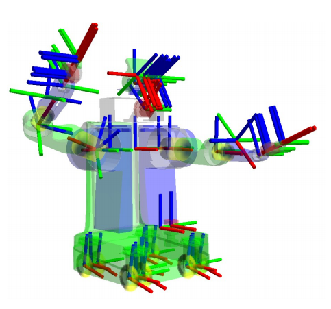
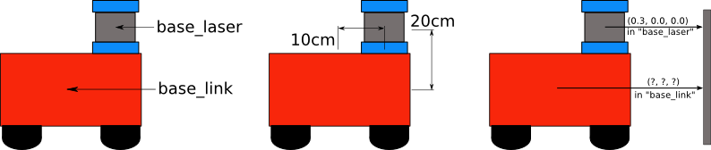
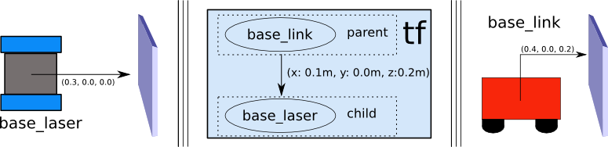
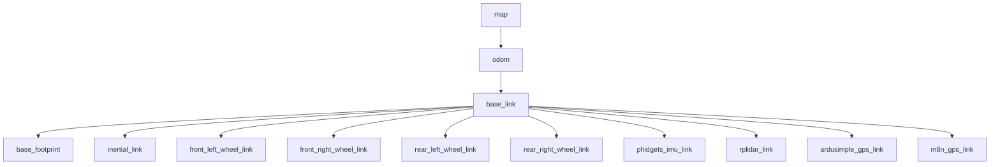

# Setting Up Transformations

In this guide, we will look at the transforms required by Nav2 and at how they are
published on SKD-1. These transforms allow Nav2 to interpret information coming from sensors
and odometry by converting it to the coordinate frames where it is needed. Below is what a
full transform tree looks like; we will start with something much simpler and then look at
the real SKD-1 tree.



First we give a brief introduction to transforms in ROS. Second, we run a simple command-line
demo of a TF2 static publisher using the real position of SKD-1's lidar. Lastly, we outline
the transforms Nav2 needs and show who publishes each one on SKD-1.

## Transforms Introduction

> [!NOTE]
> This section has been adapted from the [Setting Up Your Robot using tf](http://wiki.ros.org/navigation/Tutorials/RobotSetup/TF)
> tutorial in the ROS (1) Navigation documentation.

Many ROS packages require the transform tree of a robot to be published using TF2. A
transformation tree defines the relations between different coordinate systems in terms of
translation, rotation, and relative motion. To make this concrete, consider a simple robot
with a mobile base and a single laser sensor mounted on top.

This robot has two coordinate frames: one at the center of the mobile base and one at the
center of the laser. We call the first `base_link` and the second `base_laser`. Laser data
arrives in the `base_laser` frame, but to avoid obstacles the base needs it in the
`base_link` frame, so we must define the relationship between the two frames.



If the laser is mounted 10 cm forward and 20 cm above the center of the base, then going from
`base_link` to `base_laser` requires a translation of (x: 0.1 m, y: 0.0 m, z: 0.2 m), and
going the other way requires the opposite translation.

We could manage this ourselves, but it becomes painful as the number of frames grows.
Instead we define the relationship once with TF2 and let it handle the conversions. This is
especially useful for non-static transforms, such as a robot base moving in the map frame.

TF2 stores frames as a tree. Each node is a coordinate frame and each edge is the transform
from a parent to its child. The tree structure guarantees there is a single path between any
two frames.



We choose `base_link` as the parent because any further sensor will most naturally be related
to the robot by going through `base_link`. With the tree set up, converting a laser scan from
`base_laser` to `base_link` is a single call to the TF2 library.

## Static Transform Publisher Demo

> [!WARNING]
> If you are new to ROS 2 or do not have a working environment yet, set up your machine using
> the [ROS 2 Installation Documentation](https://docs.ros.org/en/jazzy/Installation.html) and
> the [workspace guide](../workspace/setup_workspace.md).

SKD-1's RPLidar C1 is defined in `skd1_description/urdf/skd1_core.urdf.xacro` by a fixed joint
from `base_link` to `rplidar_link` with origin `x = 0.075 m`, `z = 0.1238 m` (chassis height
0.094 m plus 0.0298 m) and a yaw of π, because the sensor is mounted rotated. Let us publish
that same transform by hand with the `static_transform_publisher` tool of TF2:

``` shell
ros2 run tf2_ros static_transform_publisher --x 0.075 --y 0 --z 0.1238 --roll 0 --pitch 0 --yaw 3.14159 --frame-id base_link --child-frame-id rplidar_link
```

In a second terminal, check it with `tf2_echo`:

``` shell
ros2 run tf2_ros tf2_echo base_link rplidar_link
```

You should see repeated output similar to this (the yaw of π is a rotation about Z, so the
quaternion is close to `[0, 0, 1, 0]`):

``` shell
At time 0.0
- Translation: [0.075, 0.000, 0.124]
- Rotation: in Quaternion [0.000, 0.000, 1.000, 0.000]
```

Do not use this approach for the real robot. We only used it to see TF2 in action. SKD-1
publishes all of its fixed transforms from the URDF with the `robot_state_publisher`, which is
the subject of the [next guide](../urdf/setup_urdf.md).

> [!NOTE]
> **See also:**
> For more on TF2, see the official [TF2 Documentation](https://docs.ros.org/en/jazzy/Tutorials/Intermediate/Tf2/Tf2-Main.html).

## Transforms in Navigation2

Two ROS REPs are worth reading. Nav2 follows both:

1.  [REP 105 - Coordinate Frames for Mobile Platforms](https://www.ros.org/reps/rep-0105.html)
2.  [REP 103 - Standard Units of Measure and Coordinate Conventions](https://www.ros.org/reps/rep-0103.html)

REP 105 defines the naming and meaning of `base_link`, `odom` and `map`. `base_link` is
attached to the robot chassis, `odom` is a fixed frame relative to the robot's starting
position used for locally consistent distances, and `map` is a world-fixed frame used for
globally consistent distances. REP 103 specifies right-handed frames with Z up and X forward,
and SI units.

Nav2 requires these transforms:

1.  `map` => `odom`
2.  `odom` => `base_link`
3.  `base_link` => sensor frames (for example `rplidar_link`)

## The SKD-1 Transform Tree



| Transform | Published by | Source file |
|---|---|---|
| `map` => `odom` | Global EKF (`ekf_global_map_filter_node`) | `skd1_localization/config/ekf_global_map.yaml` |
| `odom` => `base_link` | Local EKF (`ekf_filter_node`) | `skd1_localization/config/ekf.yaml` |
| `base_link` => `base_footprint`, `inertial_link`, sensors | `robot_state_publisher` (fixed joints) | `skd1_description/urdf/skd1_core.urdf.xacro` |
| `base_link` => wheel links | `robot_state_publisher`, driven by `/joint_states` | `skd1_description/urdf/wheel.urdf.xacro` |

Three details are specific to SKD-1:

-   **The wheel controller does not publish `odom` => `base_link`.** In
    `skd1_control/config/diff_drive_controller.yaml`, `enable_odom_tf` is `false`. The local
    EKF fuses the controller's odometry with the IMU and publishes the transform instead
    (see [Fusing Odometry with Robot Localization](../odom/setup_robot_localization.md)).
-   **SLAM does not publish `map` => `odom`.** In `skd1_navigation/config/mapper_params_online_async.yaml`,
    `transform_publish_period` is `0.0`, which disables the `slam_toolbox` transform broadcast. The
    global EKF fuses the SLAM pose and publishes `map` => `odom` (see
    [Mapping and Localization](../sensors/mapping_localization.md)). Only one node may
    publish a given transform, so do not re-enable both.
-   **`base_link` is not on the ground.** It sits at the center of the chassis plate.
    `base_footprint` is the point on the ground below it, 0.0928 m lower (wheel axle height
    0.0328 m plus wheel radius 0.06 m). Nav2's AMCL, the collision monitor and `slam_toolbox` use `base_footprint`, while the
    costmaps and navigators use `base_link`. Both are valid because they are rigidly connected.

To check any of this on a running system:

``` shell
ros2 run tf2_tools view_frames
ros2 run tf2_ros tf2_echo odom base_link
ros2 run tf2_ros tf2_echo base_link rplidar_link
```

<!-- TODO(screenshot): view_frames output (frames.pdf converted to png) for SKD-1 running in Gazebo -->

## Conclusion

In this guide we discussed transforms and the three transforms Nav2 requires. We also looked at who
publishes each of them on SKD-1. In most robotics projects the static transforms come from a
URDF and the `robot_state_publisher`. We cover that for SKD-1 in the next guide.
